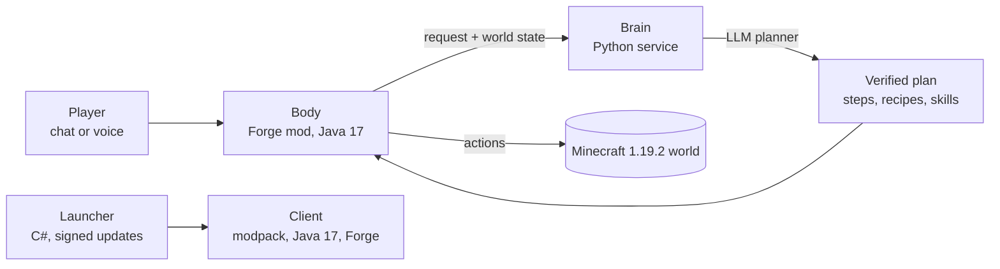

# MaxBob — an AI companion for Minecraft

[Русская версия](README.ru.md)

Concept art.

**MaxBob Legacy 2.0** is an independent Minecraft Java server (1.19.2, Forge) where every player gets a personal AI
companion, Bob. You ask him in chat or by voice; he plans the job, does it in the world and tells you when something
goes wrong. The server and the bot have been a free open beta since 14 October 2026.

[Website](https://mc.maxbob.xyz) · [Player guide](https://mc.maxbob.xyz/guide.html) ·
[Live AI statistics](https://mc.maxbob.xyz/stats.html) · Server address: `play.maxbob.xyz`

> This repository is a public showcase of the project: what it is, how it is built, and media. The source code — the
> mod, the brain, the launcher and the operations — is private. The game and the website are in Russian.

## What Bob does

- **Understands plain requests**, typed in chat or spoken (hold **Z**). "Bob, bring 32 oak logs" becomes a plan —
  prepare a tool, find and cut wood, bring it to the owner — which he carries out and reports on. You can stop him at
  any moment (`/bot stop`, `/bot resume`, `/bot cancel`).
- **Gathers, crafts and keeps order**: mining and wood, crafting chains, chests and storage, and the first machines of
  the tech mods — IC² Classic, BuildCraft, Immersive Engineering and Thermal.
- **Goes along**: the shared world, the Nether, the Twilight Forest; returns home or teleports to you (`/bot home`,
  `/bot tp`).
- **Respects ownership**: factories, reactors and apiaries are built only on the player's claimed land; a player can
  lend their bot to a friend for a few minutes (`/bot allow NAME 10`) and grant friends access per territory, chunk or
  chest.
- **Is honest about limits**: he can misread a request or not know a way, and complex jobs are still being improved —
  it is a beta.

## How it works

- **Body** — a Forge mod (Java 17): the bot entity and everything it does in the world — movement (paths, breathing,
  the way back, jetpack flight, portals), inventory and storage, combat, machines. Every player's bot keeps its
  profile, items and paused tasks between sessions.
- **Brain** — a Python service. An LLM planner turns a request into steps, and the brain checks them before the body
  acts: a crafting planner over the modpack's real recipes (a knowledge base built from the pack export, one recipe per
  item, prices solved as a fixpoint); world skills verified by postconditions — asking for a farm has to produce a
  farm, not an item with a similar name; domain modules such as an IC2 reactor simulator, Forestry bee breeding,
  factory lines and lava power.
- **Command lifecycle** — epochs, leases and cancels: a stop cancels a plan that is still being made, a timed-out
  request is retried once and only while it is still the owner's latest line, and a late answer never overrides a
  newer command. A fair bounded queue, load limits and quotas share the model between players; every owner has a
  private memory.
- **Launcher** — a native Windows app (C#): installs the modpack, Java 17 and Forge (about 300 MB on the first run),
  updates through a signed release channel and keeps the player's settings, worlds and maps, with backups. A manual
  Prism (MRPACK) install is also available.
- **Website** — a static site with live statistics of the AI's work over the last 7 days: active bots, planner calls,
  tokens.

## Engineering

- Lab copies of the server run scenario tests for every area the bot touches; a test gate stands before each release;
  craft matrices are compared with a baseline after planner changes.
- A release ships from a tagged commit: the build of exactly that commit, a world backup before the restart, the
  previous brain restored if anything fails.
- Claims, ownership and permissions are enforced by the server, not by the model: the bot can't take what its owner
  may not.

Bob in the game, by day and by night: a robot of dark plates with mint eyes.

Concept art.

## Stack

Java 17 · Minecraft Forge 43.5.0 (Minecraft 1.19.2) · Gradle · Python 3 · C# / .NET · HTML, CSS, JavaScript · Linux,
Docker, systemd

## Status

Open beta, free: no subscription, no card. Build 2.0.37, launcher 1.4.3 (22 October 2026). Windows 10/11 x64; a
Minecraft Java Edition licence is required. An unofficial project, not approved by or associated with Mojang or
Microsoft.

## Author

Maksym Babenko — [portfolio](https://cv.maxbob.xyz/) · [GitHub](https://github.com/mazamaka) ·
[Telegram](https://t.me/Mazamaka). Also by me: [Ember Foundry](https://github.com/mazamaka/ember-foundry-game), a
factory-building and tower-defense game made with Godot 4.

© 2026 Maksym Babenko. The text and images in this repository: all rights reserved.
