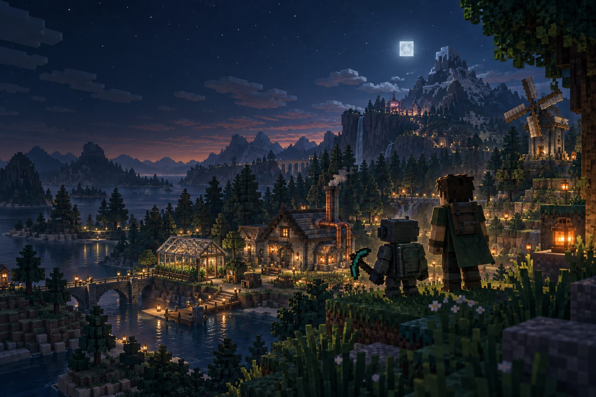
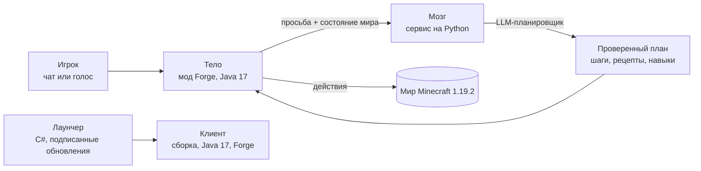
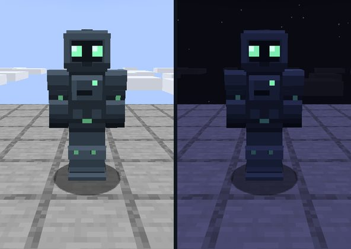

# MaxBob — ИИ-напарник в Minecraft

[English version](README.md)

Концепт-арт.

**MaxBob Legacy 2.0** — независимый сервер Minecraft Java (1.19.2, Forge), где у каждого игрока есть личный
ИИ-напарник Боб. Его просят в чате или голосом: он составляет план, выполняет его в мире и сообщает, если что-то не
получилось. Сервер и бот — бесплатная открытая бета с 14 октября 2026 года.

[Сайт](https://mc.maxbob.xyz) · [Памятка игрока](https://mc.maxbob.xyz/guide.html) ·
[Статистика ИИ](https://mc.maxbob.xyz/stats.html) · Адрес сервера: `play.maxbob.xyz`

> Это публичная витрина проекта: что это, как устроено и материалы. Исходный код — мод, мозг, лаунчер и эксплуатация —
> закрыт. Игра и сайт — на русском языке.

## Что умеет Боб

- **Понимает просьбы словами** — в чате или голосом (удерживай **Z**). «Боб, принеси 32 дубовых бревна» превращается
  в план — подготовить инструмент, найти и добыть древесину, принести владельцу, — который он выполняет и о котором
  отчитывается. Остановить его можно в любой момент (`/bot stop`, `/bot resume`, `/bot cancel`).
- **Добывает, крафтит и наводит порядок**: руда и древесина, цепочки крафта, сундуки и хранилища, первые механизмы
  технических модов — IC² Classic, BuildCraft, Immersive Engineering и Thermal.
- **Ходит вместе с тобой**: общий мир, Незер, Сумеречный лес; возвращается домой или телепортируется к тебе
  (`/bot home`, `/bot tp`).
- **Уважает чужое**: фабрики, реакторы и пасеки строит только на заприваченной земле игрока; бота можно одолжить другу
  на несколько минут (`/bot allow ИМЯ 10`), а друзьям выдать права на территорию, чанк или сундук.
- **Честен насчёт границ**: может неверно понять просьбу или не знать способа, сложные задания ещё совершенствуются —
  это бета.

## Как это устроено

- **Тело** — мод Forge (Java 17): сущность бота и всё, что он делает в мире, — движение (пути, дыхание, дорога назад,
  полёт на джетпаке, порталы), инвентарь и хранилища, бой, машины. Бот каждого игрока сохраняет профиль, вещи и
  приостановленные задачи между входами.
- **Мозг** — сервис на Python. LLM-планировщик превращает просьбу в шаги, а мозг проверяет их до того, как тело начнёт
  действовать: планировщик крафта по настоящим рецептам сборки (база знаний из экспорта сборки, один рецепт на
  предмет, цены как неподвижная точка); навыки мира с проверкой результата — просьба построить ферму должна дать ферму,
  а не предмет с похожим названием; предметные модули вроде симулятора реакторов IC2, разведения пчёл Forestry,
  производственных линий и питания от лавы.
- **Жизненный цикл команд** — эпохи, аренды и отмены: «стоп» отменяет и ещё не готовый план, просьба после тайм-аута
  повторяется один раз и только пока она — последняя реплика владельца, а запоздалый ответ никогда не перебивает
  новую команду. Справедливая ограниченная очередь, лимиты нагрузки и квоты делят модель между игроками; у каждого
  владельца — своя память.
- **Лаунчер** — нативное приложение для Windows (C#): ставит сборку, Java 17 и Forge (около 300 МБ при первом запуске),
  обновляется через подписанный канал релизов и сохраняет настройки, миры и карты игрока с резервными копиями. Есть и
  ручная установка через Prism (MRPACK).
- **Сайт** — статичный, с живой статистикой работы ИИ за 7 дней: активные боты, вызовы планировщика, токены.

## Инженерия

- Лабораторные копии сервера гоняют сценарии по каждой области, которой касается бот; перед каждым релизом — набор
  тестов-ворот; после изменений планировщика матрицы крафта сравниваются с эталоном.
- Релиз выходит из помеченного коммита: сборка ровно этого коммита, резервная копия мира перед перезапуском, возврат
  прежнего мозга при любой ошибке.
- Приваты, собственность и права проверяет сервер, а не модель: бот не возьмёт то, что не может взять его владелец.

Боб в игре днём и ночью: робот из тёмных пластин с мятными глазами.

Концепт-арт.

## Стек

Java 17 · Minecraft Forge 43.5.0 (Minecraft 1.19.2) · Gradle · Python 3 · C# / .NET · HTML, CSS, JavaScript · Linux,
Docker, systemd

## Статус

Открытая бета, бесплатно: без подписки и банковской карты. Сборка 2.0.37, лаунчер 1.4.3 (22 октября 2026). Windows
10/11 x64; нужна лицензия Minecraft Java Edition. Неофициальный проект: не одобрен Mojang или Microsoft и не связан
с ними.

## Автор

Максим Бабенко — [портфолио](https://cv.maxbob.xyz/) · [GitHub](https://github.com/mazamaka) ·
[Telegram](https://t.me/Mazamaka). Ещё мой проект — [Ember Foundry](https://github.com/mazamaka/ember-foundry-game),
игра про фабрику и оборону башнями на Godot 4.

© 2026 Максим Бабенко. Тексты и изображения в этом репозитории: все права защищены.
